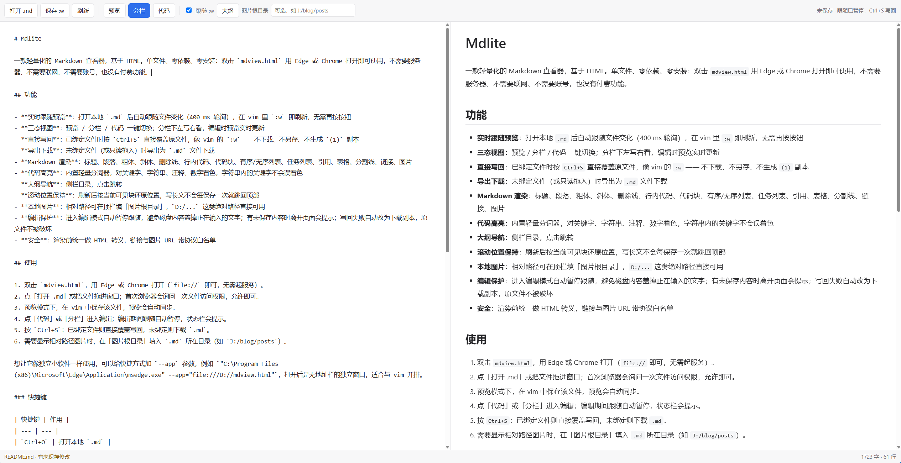

# Mdlite

English | [简体中文](./README.zh.md)

A lightweight Markdown viewer built on HTML. Single file, zero dependencies, zero installation: double-click `mdview.html` and open it in Edge or Chrome — no server, no network, no account, no paid features.

## Features

- **Bilingual UI**: English by default. Click the `中文` button in the toolbar to switch the whole interface to Chinese (click `English` to switch back). The choice is remembered in `localStorage`.
- **Live-follow preview**: after opening a local `.md`, the view follows file changes automatically (400 ms polling). Saving with `:w` in vim refreshes it — no button press needed.
- **Three view modes**: Preview / Split / Code, one click each. Split shows the editor on the left and a live-updating preview on the right.
- **Direct write-back**: with a bound file, `Ctrl+S` overwrites the original in place, like vim's `:w` — no download, no Save As, no `(1)` duplicate.
- **Export**: without a bound file (or after a read-only drop), saves the content as a downloaded `.md`.
- **Markdown rendering**: headings, paragraphs, bold, italic, strikethrough, inline code, fenced code blocks, ordered/unordered lists, task lists, blockquotes, tables, horizontal rules, links and images.
- **Syntax highlighting**: built-in lightweight tokenizer colors keywords, strings, comments and numbers; keywords inside strings are not colored by mistake.
- **Outline navigation**: sidebar table of contents, click a heading to jump.
- **Scroll position retention**: restores by the currently visible block after a refresh, so long documents do not jump back to the top on every save.
- **Local images**: relative paths resolve against the **HTML file's directory** by default. If the image lives elsewhere, set **Image root** in the toolbar (remembered, one-time only); `D:/...` absolute paths work directly. A failed load shows a hint containing the resolved path instead of a silent broken image.
- **Editing protection**: entering edit mode pauses live-follow so disk content cannot overwrite what you are typing; leaving with unsaved changes triggers a warning; a failed write-back downloads a copy instead, leaving the original file untouched.
- **Safety**: everything is HTML-escaped before rendering, and link / image URLs pass a protocol allowlist.

## Usage

1. Double-click `mdview.html` and open it in Edge or Chrome (`file://` is enough; no server needed).
2. Click `Open .md` or drop a file into the window; the browser asks for file access permission once — allow it.
3. In Preview mode, saving that file in vim refreshes the preview automatically.
4. Click `Code` or `Split` to edit; live-follow pauses while editing and the status bar says so.
5. Press `Ctrl+S`: with a bound file it overwrites it in place; otherwise the `.md` is downloaded.
6. Images use ``. Relative paths are based on the **HTML file's directory**, so the simplest setup is to keep the image next to `mdview.html`. If the image sits next to the `.md` while the HTML is elsewhere, set **Image root** to that directory (e.g. `J:/Tools/Mdlite`; remembered after one entry). Absolute paths such as `J:/Tools/Mdlite/view.png` also work.
7. The interface starts in **English**. Click `中文` in the toolbar to switch every label, status message and hint to Chinese; the button then reads `English` and switches back. The preference is stored in `localStorage` — clear browser site data to return to the English default. The document's language and the UI language are independent.

To use it like a standalone app, add `--app` to a shortcut, e.g. `"C:\Program Files (x86)\Microsoft\Edge\Application\msedge.exe" --app="file:///D:/mdview.html"`. This opens a clean window without an address bar, which sits nicely beside vim.

### Keyboard shortcuts

| Shortcut | Action |
| --- | --- |
| `Ctrl+O` | Open a local `.md` |
| `Ctrl+S` | Save (bound = overwrite in place / unbound = download) |
| `Ctrl+E` | Toggle Code / Preview |
| `Ctrl+P` | Return to Preview |
| `F5` | Discard unsaved changes and re-read from disk |
| `Tab` | Indent by two spaces in the editor |

### File read / write behavior

| State | Toolbar button | Result |
| --- | --- | --- |
| Bound to a local file via `Open .md` or drag & drop | `Save :w` | Overwrites the original file; no download |
| No file open / read-only static preview / editing a blank document | `Export .md` | Downloads a `.md` file |
| Bound, but write permission denied | `Save :w` | Reports the failure and downloads a copy; the original is unchanged |

## Project structure

| File | Purpose |
| --- | --- |
| `mdview.html` | The entire tool — one self-contained HTML file, no build step |
| `README.md` | English documentation (default) |
| `README.zh.md` | Chinese documentation |
| `view.png` | Screenshot |
| `LICENSE` | Apache License 2.0 |

## Implementation status

All features listed above are implemented. The current release is a single-file delivery with no build step, no dependency installation and no configuration file. There are no third-party runtime dependencies: the Markdown renderer, syntax highlighter and styles are all written from scratch, and only standard browser APIs are used.

Known limitations:

- Requires the File System Access API, i.e. a Chromium-based browser (Edge / Chrome). Firefox and Safari cannot read or write local files directly.
- Under `file://`, the first file open and the first write each require a one-time permission grant.
- If vim saves by writing a temporary file and renaming it (`backupcopy=no`), the file handle becomes invalid; the page detects and reports it. Use `:set backupcopy=yes` or reopen the file.
- Editing and live-follow are mutually exclusive: follow pauses while editing and resumes after a successful write-back; unsaved content keeps it paused until write-back or `F5`.
- The built-in Markdown renderer is a compact implementation covering common CommonMark / GFM syntax. Full edge-case compatibility is not guaranteed; LaTeX math and Mermaid diagrams are not supported.
- The File System Access API does not expose the full path of a `.md`, so relative images cannot be resolved against the `.md` directory automatically. Set **Image root** when the image and the HTML file are in different folders.
- The UI language preference is stored in `localStorage`; clearing browser site data resets it to English.
